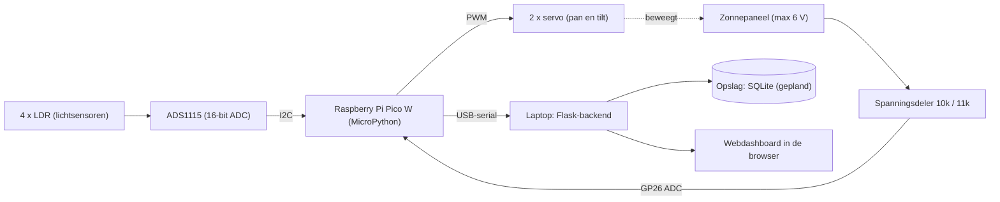

# ☀️ Smart Solar Tracker

Een zonnepaneel op twee servo's dat automatisch het licht volgt, met een live dashboard op de laptop dat de lichtwaarden, de servohoeken en de paneelspanning toont.

> Project IoT, eerste semester. Gemaakt door **[jouw naam]**, **[opleiding / school]**.

## Inhoud

1. [Probleemstelling](#probleemstelling)
2. [Toepassing en doelgroep](#toepassing-en-doelgroep)
3. [Werking](#werking)
4. [Blokschema](#blokschema)
5. [Hardware](#hardware)
6. [Aansluitschema](#aansluitschema)
7. [Technologiekeuzes](#technologiekeuzes)
8. [Installatie en gebruik](#installatie-en-gebruik)
9. [Configuratie](#configuratie)
10. [Bestanden in deze repo](#bestanden-in-deze-repo)
11. [Beperkingen en uitbreidingen](#beperkingen-en-uitbreidingen)

---

## Probleemstelling

Een vast zonnepaneel staat meestal niet de hele dag optimaal naar de zon gericht. Door de beweging van de zon valt het licht een groot deel van de dag schuin in, waardoor het paneel minder energie opbrengt dan mogelijk. Daarnaast heeft een gebruiker zonder meetsysteem geen zicht op hoe goed het paneel op een bepaald moment presteert.

**Doel:** een slim zonnepaneel dat automatisch het licht volgt en zijn prestaties live meet en toont.

## Toepassing en doelgroep

- **Toepassing:** een zonnevolgend paneel met twee assen (pan en tilt) en een dashboard met lichtverdeling, servohoeken en paneelspanning.
- **Doelgroep:** particulieren en makers met een klein paneel (bijvoorbeeld tuin, caravan of boot) en onderwijs, waar je het principe van zonvolgen en dataloggen kunt demonstreren.

## Werking

1. Vier LDR's (lichtgevoelige weerstanden) zitten in een kruis rond het paneel en worden uitgelezen via een ADS1115 (16-bit ADC).
2. De Pico vergelijkt links tegen rechts (pan) en boven tegen onder (tilt) met de formule `(a - b) / (a + b)`.
3. Is het verschil groter dan een drempel (`DREMPEL`), dan draait de bijbehorende servo een stap richting het meeste licht. De stapgrootte is evenredig met de fout (`KP`), begrensd tussen `STAP_MIN` en `STAP_MAX`. De drempel voorkomt dat de servo's blijven trillen.
4. De spanning van het paneel wordt gemeten via een spanningsdeler op een ADC-pin van de Pico.
5. De Pico stuurt elke 500 ms een regel met alle meetwaarden via USB-serial naar de laptop.
6. Een Flask-backend op de laptop leest de regels, rekent de paneelspanning om en toont alles op een webdashboard.

## Blokschema



## Hardware

| Onderdeel | Aantal | Functie |
|---|---|---|
| Raspberry Pi Pico W | 1 | Microcontroller (MicroPython), leest sensoren en stuurt servo's |
| ADS1115 (I2C ADC-module) | 1 | Leest de 4 LDR's met 16-bit resolutie |
| LDR (lichtgevoelige weerstand) | 4 | Meten het licht in vier hoeken |
| Vaste weerstand per LDR | 4 | Vormt met de LDR een spanningsdeler *(waarde: [vul in])* |
| Servo | 2 | Pan (links/rechts) en tilt (omhoog/omlaag) |
| Klein zonnepaneel (max 6 V) | 1 | Wordt gevolgd en gemeten |
| Weerstand 10 kΩ en 11 kΩ | 2 | Spanningsdeler voor de paneelspanning |
| USB-kabel (data) | 1 | Voeding en seriële verbinding met de laptop |
| Voeding servo's | 1 | *[vul in: bijvoorbeeld externe 5 V of via USB]* |

## Aansluitschema

| Van | Naar | Opmerking |
|---|---|---|
| ADS1115 SDA | Pico GP0 (I2C0 SDA) | I2C, 400 kHz |
| ADS1115 SCL | Pico GP1 (I2C0 SCL) | I2C, 400 kHz |
| ADS1115 VDD / GND | Pico 3V3 / GND | |
| LDR 1 tot 4 | ADS1115 A0 tot A3 | Elke LDR in een spanningsdeler met een vaste weerstand |
| Servo pan (signaal) | Pico GP15 | PWM 50 Hz |
| Servo tilt (signaal) | Pico GP14 | PWM 50 Hz |
| Paneel plus | 10 kΩ, daarna Pico GP26 | Bovenste weerstand van de deler |
| Pico GP26 | 11 kΩ, daarna GND | Onderste weerstand van de deler |
| Paneel min | GND | Gemeenschappelijke massa |

Bij 6 V op het paneel staat er ongeveer 3,14 V op GP26, wat onder de 3,3 V-limiet van de Pico blijft.

> *Voeg hier een foto of een Fritzing-schema toe, bijvoorbeeld in de map `docs/`:*
> ``

## Technologiekeuzes

| Onderdeel | Keuze | Waarom |
|---|---|---|
| Microcontroller | Raspberry Pi Pico W | Goedkoop, meerdere PWM-uitgangen voor servo's, I2C en ADC aanwezig en snel te programmeren in MicroPython. Wifi en Bluetooth zijn beschikbaar voor uitbreiding. |
| Lichtsensoren | 4 LDR's in kruisopstelling | Goedkoop en eenvoudig. Vier sensoren geven richtingsinformatie voor twee assen. |
| ADC voor LDR's | ADS1115 via I2C | De Pico heeft slechts drie ADC-ingangen en daarvan is er één nodig voor het paneel. De ADS1115 voegt vier kanalen toe en meet nauwkeuriger (16 bit). |
| Aandrijving | 2 servo's | Directe hoeksturing van twee assen via PWM, zonder extra driver. |
| Spanningsmeting | Spanningsdeler 10 kΩ / 11 kΩ | Het paneel levert tot 6 V, de Pico-ADC verdraagt maximaal 3,3 V. |
| Communicatie | USB-serial | Het schoolnetwerk blokkeert wifi. USB werkt zonder netwerk, is betrouwbaar en eenvoudig te debuggen. |
| Backend | Python met Flask | Ontvangt de seriële data, rekent om en levert een JSON-API aan het dashboard. Draait lokaal op de laptop. |
| Opslag | SQLite *(gepland)* | Geen server nodig, één bestand, geschikt voor historische metingen. |
| Dashboard | HTML, CSS en JavaScript | Draait in elke browser en tekent de grafieken zelf op canvas, dus geen internet of externe library nodig. |

## Installatie en gebruik

### 1. Pico W

1. Installeer [MicroPython voor de Pico W](https://micropython.org/download/RPI_PICO_W/) (houd BOOTSEL ingedrukt bij het aansluiten en kopieer het `.uf2`-bestand).
2. Open [Thonny](https://thonny.org/) en kies als interpreter *MicroPython (Raspberry Pi Pico)*.
3. Sla deze bestanden op de Pico op: `ads1115.py`, `mainprog.py` en `main.py`.
4. `main.py` bevat alleen deze regel, zodat de tracker automatisch start bij het aansluiten:
   ```python
   import mainprog
   ```
5. Koppel de Pico los en weer aan. De servo's gaan naar hun startpositie en beginnen het licht te volgen.

### 2. Laptop (dashboard)

1. Installeer Python 3 en de packages:
   ```bash
   pip install pyserial flask
   ```
2. **Sluit Thonny**, want die houdt de seriële poort bezet.
3. Zoek de poort van de Pico: Apparaatbeheer → Poorten (COM & LPT) op Windows, `ls /dev/ttyACM*` op Linux of `ls /dev/tty.usbmodem*` op Mac.
4. Zet die poort bovenaan in `dashboard.py` bij `POORT` (bijvoorbeeld `"COM11"`).
5. Start het dashboard:
   ```bash
   python dashboard.py
   ```
6. Open `http://localhost:5000` in je browser.

### Problemen oplossen

| Probleem | Oplossing |
|---|---|
| `PermissionError` of `could not open port` | Een ander programma gebruikt de poort (meestal Thonny). Sluit het en koppel de Pico los en weer aan. |
| Dashboard blijft op 0 | Controleer `POORT` en of `main.py` op de Pico staat. |
| Paneelspanning klopt niet | Controleer `R_BOVEN`, `R_ONDER` en `KALIBRATIE` in `dashboard.py` met een multimeter. |

## Configuratie

**Pico (`mainprog.py`)**

| Parameter | Betekenis |
|---|---|
| `DREMPEL` | Minimale fout voordat een servo beweegt |
| `KP` | Versterking: hoe sterk de stap meegroeit met de fout |
| `STAP_MIN`, `STAP_MAX` | Minimale en maximale stap per ronde (graden) |
| `PAN_RICHTING`, `TILT_RICHTING` | Draairichting van de servo's (1 of -1) |
| `OFFSET_PAN`, `OFFSET_TILT` | Correctie als de LDR's niet identiek zijn |
| `PAN_MIN/MAX`, `TILT_MIN/MAX` | Bewegingsbereik van de servo's |

**Dashboard (`dashboard.py`)**

| Parameter | Betekenis |
|---|---|
| `POORT` | Seriële poort van de Pico |
| `R_BOVEN`, `R_ONDER` | Weerstanden van de spanningsdeler (10 kΩ en 11 kΩ) |
| `KALIBRATIE` | Correctiefactor na vergelijking met een multimeter |
| `MAX_PUNTEN` | Aantal punten dat de grafieken tonen |

### Seriële datastroom

Elke 500 ms stuurt de Pico één regel:

```
D,<ldr1>,<ldr2>,<ldr3>,<ldr4>,<h-fout>,<v-fout>,<pan-hoek>,<tilt-hoek>,<paneel-raw>
```

`paneel-raw` is de 16-bit ADC-waarde (0 tot 65535) van GP26. Het dashboard rekent die om met `raw / 65535 * 3.3 * (R_BOVEN + R_ONDER) / R_ONDER`.

## Bestanden in deze repo

| Bestand | Functie |
|---|---|
| `mainprog.py` | Hoofdprogramma op de Pico: LDR's lezen, servo's aansturen, data versturen |
| `main.py` | Start `mainprog` automatisch bij het opstarten van de Pico |
| `ads1115.py` | Driver voor de ADS1115 |
| `dashboard.py` | Flask-backend en webdashboard op de laptop |
| `README.md` | Deze documentatie |

## Beperkingen en uitbreidingen

- De communicatie is bedraad (USB-serial). Uitbreiding naar BLE of een eigen wifi-hotspot is mogelijk.
- Historische opslag (SQLite) is gepland. Het dashboard toont nu de laatste ongeveer 2,5 minuten en een gemiddelde sinds het starten.
- De LDR-waarden zijn ruwe ADC-waarden en nog niet omgerekend naar volt of een percentage.
- Stroom en vermogen worden niet gemeten. Daarvoor is bijvoorbeeld een INA219 nodig.

## Licentie

*[Optioneel: voeg een licentie toe, bijvoorbeeld MIT.]*
