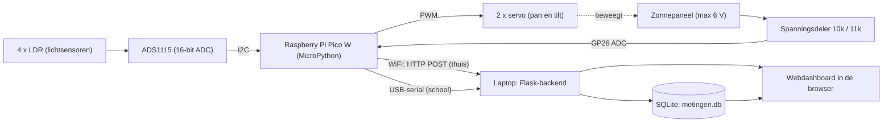

# ☀️ Smart Solar Tracker

Een zonnepaneel op twee servo's dat automatisch het licht volgt, met een live dashboard op de laptop. Het dashboard toont de lichtwaarden (in volt), de servohoeken en de paneelspanning, en bewaart alle metingen in een database zodat je de historie kunt bekijken.

> Project IoT, eerste semester. Gemaakt door **Matteo Belmans**.

## Inhoud

1. [Probleemstelling](#probleemstelling)
2. [Toepassing en doelgroep](#toepassing-en-doelgroep)
3. [Werking](#werking)
4. [Blokschema](#blokschema)
5. [Hardware](#hardware)
6. [Aansluitschema](#aansluitschema)
7. [Technologiekeuzes](#technologiekeuzes)
8. [Installatie en gebruik](#installatie-en-gebruik)
9. [Configuratie](#configuratie)
10. [Opslag en API](#opslag-en-api)
11. [Bestanden in deze repo](#bestanden-in-deze-repo)
12. [Beperkingen en uitbreidingen](#beperkingen-en-uitbreidingen)

---

## Probleemstelling

Een vast zonnepaneel staat meestal niet de hele dag optimaal naar de zon gericht. Door de beweging van de zon valt het licht een groot deel van de dag schuin in, waardoor het paneel minder energie opbrengt dan mogelijk. Daarnaast heeft een gebruiker zonder meetsysteem geen zicht op hoe goed het paneel op een bepaald moment presteert.

**Doel:** een slim zonnepaneel dat automatisch het licht volgt en zijn prestaties live meet, toont en bewaart.

## Toepassing en doelgroep

- **Toepassing:** een zonnevolgend paneel met twee assen (pan en tilt) en een dashboard met lichtverdeling, servohoeken, paneelspanning en historische metingen.
- **Doelgroep:** particulieren en makers met een klein paneel (bijvoorbeeld tuin, caravan of boot) en onderwijs, waar je het principe van zonvolgen en dataloggen kunt demonstreren.

## Werking

1. Vier LDR's (lichtgevoelige weerstanden) zitten in een kruis rond het paneel en worden uitgelezen via een ADS1115 (16-bit ADC). De ruwe waarde wordt door het dashboard omgerekend naar **volt (V)**.
2. De Pico vergelijkt links tegen rechts (pan) en boven tegen onder (tilt) met de formule `(a - b) / (a + b)`.
3. Is het verschil groter dan een drempel (`DREMPEL`), dan draait de bijbehorende servo een stap richting het meeste licht. De stapgrootte is evenredig met de fout (`KP`), begrensd tussen `STAP_MIN` en `STAP_MAX`. Dit is een gesloten regelkring met een proportionele regeling. De drempel voorkomt dat de servo's blijven trillen.
4. De spanning van het paneel wordt gemeten via een spanningsdeler op een ADC-pin van de Pico.
5. De Pico stuurt elke 500 ms alle meetwaarden naar de laptop, via **wifi (HTTP POST)** of via **USB-serial**.
6. Een Flask-backend op de laptop ontvangt de metingen, rekent ze om naar volt, bewaart ze in een **SQLite-database** en toont alles op een webdashboard.

## Blokschema



## Hardware

| Onderdeel | Aantal | Functie |
|---|---|---|
| Raspberry Pi Pico W | 1 | Microcontroller (MicroPython), leest sensoren en stuurt servo's |
| ADS1115 (I2C ADC-module) | 1 | Leest de 4 LDR's met 16-bit resolutie |
| LDR (lichtgevoelige weerstand) | 4 | Meten het licht in vier hoeken |
| Vaste weerstand per LDR | 4 | Vormt met de LDR een spanningsdeler *(waarde: [vul in])* |
| Servo | 2 | Pan (links/rechts) en tilt (omhoog/omlaag) |
| Klein zonnepaneel (max 6 V) | 1 | Wordt gevolgd en gemeten |
| Weerstand 10 kΩ en 11 kΩ | 2 | Spanningsdeler voor de paneelspanning |
| USB-kabel (data) | 1 | Voeding en seriële verbinding met de laptop |
| Voeding servo's | 1 | *[vul in: bijvoorbeeld externe 5 V of via USB]* |

## Aansluitschema

| Van | Naar | Opmerking |
|---|---|---|
| ADS1115 SDA | Pico GP0 (I2C0 SDA) | I2C, 400 kHz |
| ADS1115 SCL | Pico GP1 (I2C0 SCL) | I2C, 400 kHz |
| ADS1115 VDD / GND | Pico 3V3 / GND | |
| LDR 1 tot 4 | ADS1115 A0 tot A3 | Elke LDR in een spanningsdeler met een vaste weerstand |
| Servo pan (signaal) | Pico GP15 | PWM 50 Hz |
| Servo tilt (signaal) | Pico GP14 | PWM 50 Hz |
| Paneel plus | 10 kΩ, daarna Pico GP26 | Bovenste weerstand van de deler |
| Pico GP26 | 11 kΩ, daarna GND | Onderste weerstand van de deler |
| Paneel min | GND | Gemeenschappelijke massa |

Bij 6 V op het paneel staat er ongeveer 3,14 V op GP26, wat onder de 3,3 V-limiet van de Pico blijft.

> *Voeg hier een foto of een Fritzing-schema toe, bijvoorbeeld in de map `docs/`:*
> ``

## Technologiekeuzes

| Onderdeel | Keuze | Waarom |
|---|---|---|
| Microcontroller | Raspberry Pi Pico W | Goedkoop, meerdere PWM-uitgangen voor servo's, I2C en ADC aanwezig en snel te programmeren in MicroPython. Wifi is ingebouwd. |
| Lichtsensoren | 4 LDR's in kruisopstelling | Goedkoop en eenvoudig. Vier sensoren geven richtingsinformatie voor twee assen. |
| ADC voor LDR's | ADS1115 via I2C | De Pico heeft slechts drie ADC-ingangen en daarvan is er één nodig voor het paneel. De ADS1115 voegt vier kanalen toe en meet nauwkeuriger (16 bit). |
| Aandrijving | 2 servo's | Directe hoeksturing van twee assen via PWM, zonder extra driver. |
| Spanningsmeting | Spanningsdeler 10 kΩ / 11 kΩ | Het paneel levert tot 6 V, de Pico-ADC verdraagt maximaal 3,3 V. |
| Communicatie (hoofdroute) | HTTP over wifi | Eenvoudig, universeel en makkelijk te testen. De Pico stuurt JSON via een POST naar de backend. |
| Communicatie (alternatief) | USB-serial | Op school blokkeert het netwerk wifi. USB werkt zonder netwerk en dient als betrouwbare terugvaloptie. |
| Backend | Python met Flask | Ontvangt de data, rekent om, bewaart en levert een JSON-API aan het dashboard. Draait lokaal op de laptop. |
| Opslag | SQLite | Geen server nodig, één bestand, geschikt voor historische metingen en snel te bevragen. |
| Dashboard | HTML, CSS en JavaScript | Draait in elke browser en tekent de grafieken zelf op canvas, dus geen internet of externe library nodig. |

## Installatie en gebruik

### 1. Pico W

1. Installeer [MicroPython voor de Pico W](https://micropython.org/download/RPI_PICO_W/) (houd BOOTSEL ingedrukt bij het aansluiten en kopieer het `.uf2`-bestand).
2. Open [Thonny](https://thonny.org/) en kies als interpreter *MicroPython (Raspberry Pi Pico)*.
3. Sla deze bestanden op de Pico op: `ads1115.py`, `mainprog.py` en `main.py`.
4. `main.py` bevat alleen deze regel, zodat de tracker automatisch start bij het aansluiten:
   ```python
   import mainprog
   ```
5. **Alleen voor wifi:** kopieer `wifi_secrets_example.py`, hernoem de kopie naar `wifi_secrets.py`, vul je eigen SSID, wachtwoord en het IP-adres van je laptop in en sla het op de Pico op. Dit bestand staat in `.gitignore` en komt dus niet op GitHub.
6. Kies in `mainprog.py` de communicatie:
   - `WIFI_AAN = True`: wifi (thuis). De Pico verbindt met het netwerk en stuurt HTTP-berichten.
   - `WIFI_AAN = False`: alleen USB-serial (school).
7. Koppel de Pico los en weer aan. De servo's gaan naar hun startpositie en beginnen het licht te volgen.

> De Pico W werkt alleen op **2,4 GHz**-wifi. Het IP-adres van de laptop vind je met `ipconfig` (IPv4-adres).

### 2. Laptop (dashboard)

1. Installeer Python 3 en de packages:
   ```bash
   pip install flask pyserial
   ```
   (`pyserial` is alleen nodig voor de USB-variant.)
2. Kies de invoer bovenaan `dashboard.py`:
   - **Wifi:** `SERIAL_POORT = None`.
   - **USB:** `SERIAL_POORT = "COM11"` (jouw poort, te vinden in Apparaatbeheer → Poorten) en sluit Thonny, want die houdt de poort bezet.
   
   Gebruik één invoer tegelijk, anders worden metingen dubbel opgeslagen.
3. Controleer `ADS_LSB_V` (zie [Configuratie](#configuratie)).
4. Start het dashboard:
   ```bash
   python dashboard.py
   ```
   Windows vraagt bij wifi waarschijnlijk om toegang voor Python op het privénetwerk. Kies **Toestaan**.
5. Open `http://localhost:5000` in je browser.

### Problemen oplossen

| Probleem | Oplossing |
|---|---|
| `PermissionError` of `could not open port` (USB) | Een ander programma gebruikt de poort (meestal Thonny). Sluit het en koppel de Pico los en weer aan. |
| Dashboard toont "Geen data van de Pico" (wifi) | Controleer SSID, wachtwoord en `SERVER_IP` in `wifi_secrets.py`, of de Pico en laptop op hetzelfde netwerk zitten en of de firewall Python toelaat. |
| Pico verbindt niet met wifi | De Pico W ondersteunt alleen 2,4 GHz. |
| Paneelspanning klopt niet | Controleer `R_BOVEN`, `R_ONDER` en `KALIBRATIE` met een multimeter. |
| LDR-spanning klopt niet | Controleer `ADS_LSB_V` (zie de gain in `ads1115.py`). |

## Configuratie

**Pico (`mainprog.py`)**

| Parameter | Betekenis |
|---|---|
| `WIFI_AAN` | `True` voor wifi (HTTP), `False` voor alleen USB-serial |
| `STUUR_INTERVAL` | Tijd in ms tussen twee verzendingen |
| `DREMPEL` | Minimale fout voordat een servo beweegt |
| `KP` | Versterking: hoe sterk de stap meegroeit met de fout |
| `STAP_MIN`, `STAP_MAX` | Minimale en maximale stap per ronde (graden) |
| `PAN_RICHTING`, `TILT_RICHTING` | Draairichting van de servo's (1 of -1) |
| `OFFSET_PAN`, `OFFSET_TILT` | Correctie als de LDR's niet identiek zijn |
| `PAN_MIN/MAX`, `TILT_MIN/MAX` | Bewegingsbereik van de servo's |

**Dashboard (`dashboard.py`)**

| Parameter | Betekenis |
|---|---|
| `SERIAL_POORT` | `None` voor wifi, of de COM-poort voor USB |
| `DB_BESTAND` | Naam van de SQLite-database (`metingen.db`) |
| `OPSLAG_INTERVAL` | Seconden tussen twee opgeslagen metingen |
| `R_BOVEN`, `R_ONDER` | Weerstanden van de spanningsdeler (10 kΩ en 11 kΩ) |
| `KALIBRATIE` | Correctiefactor na vergelijking met een multimeter |
| `ADS_LSB_V` | Volt per ADC-stap van de ADS1115, afhankelijk van de gain |

**ADS1115-omrekening.** De LDR-waarden worden omgerekend met `volt = ruwe waarde * ADS_LSB_V`. De juiste waarde hangt af van de ingestelde gain in `ads1115.py`:

| Gain (bereik) | `ADS_LSB_V` |
|---|---|
| ±6,144 V | 0,0001875 |
| ±4,096 V | 0,000125 |
| ±2,048 V | 0,0000625 |
| ±1,024 V | 0,00003125 |
| ±0,512 V | 0,000015625 |
| ±0,256 V | 0,0000078125 |

Controleer de omrekening door met een multimeter de spanning over één LDR-deler te meten en die te vergelijken met het dashboard. Na het aanpassen van `ADS_LSB_V` wis je best `metingen.db`, want opgeslagen waarden zijn met de oude waarde omgerekend.

### Dataformaat

Elke 500 ms stuurt de Pico de volgende metingen.

Wifi (HTTP POST naar `/ingest`, JSON):

```json
{"ldr": [7074, 7113, 7011, 6779], "h": 0.007, "v": 0.014, "pan": 49.4, "tilt": 99.1, "raw": 31250}
```

USB-serial (één tekstregel, begint met `D,`):

```
D,<ldr1>,<ldr2>,<ldr3>,<ldr4>,<h-fout>,<v-fout>,<pan-hoek>,<tilt-hoek>,<paneel-raw>
```

`raw` is de 16-bit ADC-waarde (0 tot 65535) van GP26. Het dashboard rekent die om met `raw / 65535 * 3.3 * (R_BOVEN + R_ONDER) / R_ONDER * KALIBRATIE`.

## Opslag en API

Alle metingen worden elke `OPSLAG_INTERVAL` seconden bewaard in `metingen.db` (SQLite):

| Kolom | Inhoud |
|---|---|
| `tijd` | Tijdstip (Unix-seconden) |
| `paneel_v` | Paneelspanning in V |
| `ldr1_v` tot `ldr4_v` | LDR-waarden in V |
| `h`, `v` | Horizontale en verticale fout |
| `pan`, `tilt` | Servohoeken in graden |

| Route | Functie |
|---|---|
| `/` | Dashboard |
| `/ingest` (POST) | Ontvangt metingen van de Pico |
| `/data` | Live waarden en recente punten (JSON) |
| `/history?periode=uur\|dag\|week\|alles` | Gemiddelden per tijdsblok uit de database (JSON) |
| `/export.csv` | Alle opgeslagen metingen als CSV |

## Bestanden in deze repo

| Bestand | Functie |
|---|---|
| `mainprog.py` | Hoofdprogramma op de Pico: LDR's lezen, servo's aansturen, data versturen (wifi en USB) |
| `main.py` | Start `mainprog` automatisch bij het opstarten van de Pico |
| `ads1115.py` | Driver voor de ADS1115 |
| `wifi_secrets_example.py` | Voorbeeld voor `wifi_secrets.py` (wifi-gegevens, niet op GitHub) |
| `dashboard.py` | Flask-backend, SQLite-opslag en webdashboard op de laptop |
| `.gitignore` | Houdt `wifi_secrets.py` en de database buiten GitHub |
| `README.md` | Deze documentatie |

## Beperkingen en uitbreidingen

- De LDR-waarden zijn omgerekend naar volt, maar niet naar een absolute lichtsterkte (lux).
- Stroom en vermogen van het paneel worden niet gemeten. Daarvoor is bijvoorbeeld een INA219 nodig.
- De communicatie is niet versleuteld (HTTP). Het dashboard is bedoeld voor gebruik op een eigen, vertrouwd netwerk.
- Er is geen buffering: als de verbinding wegvalt, gaan de metingen in die periode niet naar de database.
